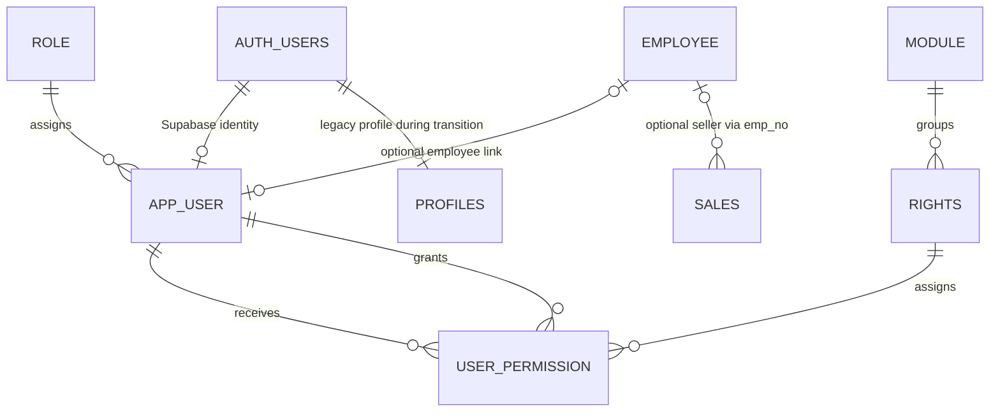

# User-management schema

## Proposed design

| Table | Key and behavior |
| --- | --- |
| `role` | Identity primary key; unique name; status/stamp; seeds Superadmin, Admin, User. |
| `app_user` | Identity primary key; one-to-one FK to Supabase Auth; lowercase unique email; User is the insert default; approval/blocking and login-throttling fields; optional unique employee link. |
| `module` | Identity primary key; stable unique module code; ordered, soft-status module catalogue. |
| `rights` | Identity primary key; stable unique permission code; module FK, action, checkbox label and order. The catalogue contains the 36 guide rights. |
| `user_permission` | `(user_id, right_id)` composite primary key; grant actor/time; soft status and latest-action stamp. Revoke/reactivate the same row; `DELETE` and `TRUNCATE` are rejected. |
| Effective-right views | `v_user_effective_rights` returns user/module/right/granted; Superadmin grants are implicit. `v_rights_counts_by_module` reports active checkbox counts. |

## ERD fragment



`app_user.employee_id` is an optional unique FK to `employee.emp_no`. It links
a login identity to an employee only when the person is represented in both
systems. `sales.emp_no` continues to mean the employee who made the sale; it
is not an authentication/audit identity and is not inferred from the current
login. When a future audit log is added, its actor FK should point to
`app_user.id`, not `employee.emp_no`.

## Supabase Auth and `public.profiles` integration

`auth.users` remains the identity and credential system of record. Supabase
Auth continues to handle registration, password verification/reset, sessions,
and OAuth. `app_user` is the ERP authorization profile: each row has a
required, unique `auth_user_id` FK to `auth.users.id`, and its `role_id`,
approval, blocked status, and permissions control application access.
`app_user.password_hash` must remain NULL for Supabase-managed accounts; the
application must never copy or verify Supabase's internal password hash.
Because permissions and account records are soft-deleted, the Auth FK uses
`ON DELETE RESTRICT`; deactivate/block the account instead of physically
deleting its Auth identity while an `app_user` row exists.

The existing registration feature branch creates `public.profiles` with
`id = auth.users.id`, a text role, and `approval_status`. It is a legacy
profile/authorization store, not a second authentication provider. During
transition, keep it in place for compatibility, backfill it into `app_user`
using [the one-time integration SQL](./integrations/001_backfill_profiles_to_app_user.sql),
and then update server authorization reads/writes to use `app_user` keyed by
the authenticated Supabase user's UUID. Map the existing role and approval
state; do not allow independent role values to drift between the two tables.
Use `auth_user_id`, not email, as the stable identity key. When an email
changes in Supabase Auth, synchronize `app_user.email` (and `profiles.email`
while it is still in use) in the same trusted server-side account-update flow.
Keep `profiles` read-only after cutover and remove it only in a later,
separately reviewed migration after all callers have moved. The current Task 3
PR base does not include the `profiles` migration, so apply the backfill only
after that migration has created `public.profiles`.

The backfill leaves Supabase credentials untouched and does not create Auth
users. Existing `profiles.role` values map to the seeded `role.name`;
`profiles.approval_status` maps to `app_user.approval_status`. Pending users
remain pending and receive no effective rights. `is_blocked` remains a
separate administrative block flag. Existing users already set their
password through Supabase Auth, so the backfill sets `must_set_password` to
false and leaves `password_hash` NULL. The database does not infer a Supabase
password from profile data.

For registrations after the cutover, the server must create the Supabase Auth
user first, then create its `app_user` row with the returned Auth UUID and the
default `User` role. Until every application path has moved, registration and
approval code must keep `profiles` and `app_user` synchronized; switch
authorization reads to `app_user` only after that dual-write/backfill is
deployed and verified. Do not have the browser choose `role_id`.

## Task coverage

- Create `app_user` with a role FK, blocked status, and login-throttling fields.
- Create the `role` and `module` catalogues.
- Create the `rights` catalogue, with each right assigned to one module.
- Define primary keys, foreign keys, uniqueness rules, and validation
  constraints in the migration.
- Verify that users reference roles, rights reference modules, and
  `user_permission` connects users to rights.

The database relationship is `auth.users -> app_user`,
`role -> app_user`, `module -> rights`, and
`app_user + rights -> user_permission`. The optional `app_user.employee_id`
relationship is documented above.

## Defaults and authorization

- New app users default to the active `User` role in a `BEFORE INSERT`
  trigger. An explicitly supplied role is retained for trusted provisioning;
  the registration endpoint must always assign `User` and must never accept
  `role_id` from the browser.
- Email is trimmed and lowercased by that trigger, and a CHECK constraint
  rejects any stored value that is not lowercase. A unique index on
  `lower(email)` also enforces case-insensitive uniqueness.
- `password_hash` stays NULL for Supabase Auth accounts; Supabase owns their
  password credentials. `must_set_password` is an onboarding flag that the
  server enforces through Supabase's password update/recovery flow. If a
  separate custom-auth provider is ever added, store only salted
  bcrypt/Argon2 hashes, never plaintext.
- A blocked account keeps its permission rows. Authentication must reject a
  blocked account independently of its permissions; blocking does not revoke
  access grants.
- Superadmin receives every active catalogue right implicitly. Do not create
  `user_permission` rows for Superadmin.
- The application server must authorize every permission grant and revoke
  against the caller's active role (Admin or Superadmin). Hiding a checkbox
  or button is not authorization. The database trigger also rejects inserts
  and reactivations unless `granted_by` identifies an active, unblocked Admin
  or Superadmin. A direct server update to revoke must set `status = 'Inactive'`
  and update `stamp` with the revoking actor and time.
- The database rejects both `DELETE` and `TRUNCATE` on `user_permission`;
  use status updates instead.
- RLS is enabled on all five tables with no end-user policies. Keep user and
  rights management server-side; do not expose the privileged database
  connection to browser code.

## Permission history

Unticking a right is a soft delete: set `status = 'Inactive'`, update `stamp`,
and keep the same `(user_id, right_id)` row. Re-ticking reactivates that row
and updates `granted_by`, `granted_at`, and `stamp`. This preserves the current
permission record but `stamp` stores only the latest action; it does not
preserve every prior grant/revoke. A separate append-only audit log is needed
if the application must retain that history.

## Verify after migration

Apply migrations through `003_create_user_management_schema.sql` in a
Supabase database where `auth.users` is available. If the registration
feature's `public.profiles` table is present, run the one-time integration
backfill after migration 003. Then run
`db/verification/verify_user_management.sql` in the same development
database. Expected active right counts are Customer 3, Product 6, Human
Resources 13, Sales 7, and Reports 7. The relationship check should find all
seven expected foreign keys and no orphan references. The RLS check should
return true; the two views and `user_permission_active_user_idx` should exist.

The effective-right view is intended for a server lookup by login email:

```sql
SELECT user_id, module_code, right_code, granted
FROM public.v_user_effective_rights
WHERE email = lower($1)
ORDER BY module_code, right_code;
```

For an active Superadmin, all 36 returned rights have `granted = true`
implicitly. A blocked account's grant rows remain intact; the sign-in flow
must separately deny that account.
