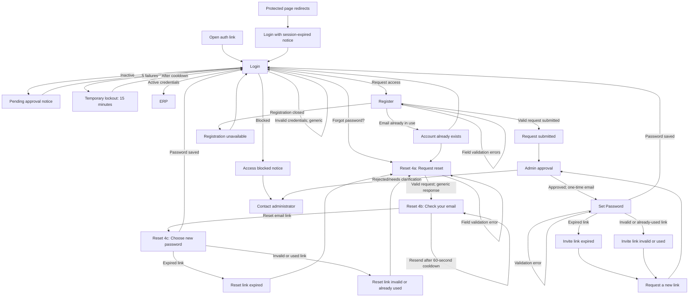

# Hope, Inc. ERP — Task 2: Authentication wireframes

## Assumptions

- The existing Hope visual direction remains: cream page, evergreen brand, simple centered auth card, and no app sidebar. Use only Task 1 tokens, Inter with its documented fallback, and the Task 1 input, password input, button, inline error, and card patterns.
- Login uses email and password. Account statuses are Active, Inactive, and Blocked; roles are Superadmin, Admin, and User.
- **Registration requests access.** In the normal approval flow, a new request is Inactive with the User role and cannot log in until an Admin approves it. This follows the Task 2 assumption; see the development-only role conflict below.
- An Admin-created account or approved request receives a one-time email link to set the first password. The link is provisionally assumed to expire after 60 minutes and to work once.
- Reset Password is the forgot-password flow for an existing account. Request and resend responses are generic, so they do not disclose whether the email is registered.
- Required registration fields come from the current project context: full name, email, password. No organization or additional fields are specified.
- The project instruction says **all signups in DEV default to `superadmin`**, which conflicts with the request-access assumption of an Inactive `User`. That is treated as an explicit development-only exception, not the production approval flow. Do not copy the wireframe's production role into development seed/sign-up behavior without resolving this conflict.
- Password policy for these wireframes: at least 12 characters, one uppercase letter, one lowercase letter, one number, and one symbol. Apply the same rules in Register, Set Password, and Choose New Password.
- Provisional security behavior where the project context is silent: lock sign-in for 15 minutes after 5 failed attempts; link lifetime is 60 minutes; resend cooldown is 60 seconds. Confirm these values with the product/security owner before implementation.

## Gaps found in Task 1

Task 1 defines a reusable text/password input, buttons, inline errors, card surfaces, status/role pills, palette, typography, and breakpoints. It does **not** define these auth-specific interaction patterns or behaviors; they are represented as compositions of existing components, not new design-system components:

- Password-rule checklist and strength indicator.
- Submission error summary and field-to-summary focus behavior.
- Session-expired notice, temporary lockout notice, and account-state sign-in messages.
- Loading/disabled form composition and an announced spinner.
- Request-submitted/check-email confirmation and resend cooldown presentation.
- One-time invite/reset-link expired, invalid, and already-used recovery views.
- Registration-closed view.
- Responsive auth-card width and placement. Task 1 defines global breakpoints and a card pattern, but not auth-specific measurements.

No new color, font, or semantic design token is introduced. Use Task 1 `--color-page`, `--color-surface`, `--color-border`, `--color-text-primary`, `--color-text-secondary`, `--color-text-disabled`, `--color-primary-600`, `--color-primary-700`, `--color-primary-800`, `--color-focus`, and the existing success/danger tokens.

## Flow diagram

## Shared layout, validation, and accessibility

- **Canvas:** `--color-page`. **Card:** centered, `--color-surface`, `--radius-lg`, `--shadow-card`. **Content width:** 440px maximum; 24px card padding on desktop/tablet, 16px on 375px mobile. Use the same logo placeholder, title, helper, fields, primary action, and secondary-link rhythm across screens.
- Desktop is 1440px (Task 1 wide layout); tablet is 768px; mobile is 375px (Task 1 single-column breakpoint). At 768px and below, remove all app navigation; the auth card remains centered. At 375px, use 16px outer gutters, full card width, and at least 44×44px touch targets. Expand Task 1's 40px input/button baseline to 44px for mobile fields, show/hide controls, buttons, and links.
- Use Task 1 page title (28/36, 600), section title (20/28, 600), body (14/20), caption/label (12/16), and button (14/20, 600) styles. No readable text below 12px.
- Use Task 1 primary button, text/password input, inline error, and focus-ring tokens unchanged. Normal text contrast is at least 4.5:1; control boundary/focus contrast at least 3:1. Error/success states include an icon or text label, never color alone.
- Put a visible label above every input; placeholders are optional examples, never labels. Errors are directly under the field, referenced with `aria-describedby`, and announced with `aria-live="polite"`/`role="alert"` as appropriate. On failed submit show a summary at the top and move focus to it.
- Validation timing: validate required fields and format on blur; after the first error, revalidate as the user edits. On submit, block only if required fields are invalid, show summary and field errors, and focus summary. Enter submits when the form is valid.
- Logical DOM/tab order follows visual order. Preserve a visible Task 1 focus ring. Password toggles have an accessible “Show password” / “Hide password” name and do not submit or clear the value.
- Autocomplete: email `email`; login password `current-password`; registration, first-time set, and reset password `new-password`; full name `name`; confirmation `new-password`.
- While submitting, disable editable fields and duplicate submission, retain values, set `aria-busy="true"`, and show a spinner with readable progress text in the primary button. Do not disable secondary recovery links unless the transition itself would conflict.
- The HTML sheet shows each screen and state as responsive wireframes at 1440px, 768px, and 375px. Desktop/tablet/mobile render the same hierarchy; mobile stacks fields and maintains the same 44px minimum hit area.

## Password rules (all three password-creation screens)

Use the exact same live checklist on Register, Set Password, and Choose New Password:

1. At least 12 characters.
2. At least one uppercase letter.
3. At least one lowercase letter.
4. At least one number.
5. At least one symbol.

The strength indicator is supporting feedback (“Weak”, “Fair”, “Strong”), not a substitute for the five labeled checks. Announce rule changes politely without announcing on every keystroke. A password is valid only when all five rules pass. Confirmation must exactly match. Registration policy is provisional because the repository has no password policy.

## Screen 1 — Login

- **Title:** Welcome back
- **Helper:** Log in to your Hope account.
- **Fields:** Email; Password with Show/Hide.
- **Links:** Forgot password? → Reset 4a. Request access → Register.
- **Primary action:** Log in.

| State | Microcopy / behavior |
|---|---|
| Default | Email label; Password label; `Forgot password?`; primary `Log in`; below form `New to Hope? Request access`. |
| Field focus | Apply visible `--color-focus` ring to the active field. No helper/error changes just from focus. |
| Empty-field validation | Summary: `Check the highlighted fields.` Email: `Enter your email address.` Password: `Enter your password.` |
| Invalid credentials | Summary and inline: `We couldn't log you in with those details. Check your email and password, then try again.` Same text for unknown email and wrong password. |
| Account Inactive | `Your account is waiting for Admin approval. You can try logging in again after it's approved.` Link: `Request access` (Register) and `Back to login`. Do not suggest a password reset solves approval. |
| Account Blocked | `This account is blocked. Contact your administrator for help.` Link: `Contact administrator` (support email or configured contact; destination is an open question). |
| Too many attempts | `Too many sign-in attempts. Try again in 15 minutes.` Disable submit until the server-provided cooldown expires; keep Forgot password available. |
| Loading | Button `Logging in…` with spinner; form controls disabled; `aria-busy="true"`. On active account, redirect to ERP. |
| Session expired | Top notice: `Your session expired. Log in again to continue.` Preserve the intended destination only after successful login; do not expose protected content. |

**Annotations**

1. Email uses `type="email"`, `autocomplete="email"`, and a persistent Email label.
2. Password uses `autocomplete="current-password"`; show/hide control has its own accessible name.
3. Invalid credentials deliberately use one generic message; never reveal account existence.
4. Inactive and Blocked use distinct labeled explanatory messages. Both remain recoverable; only Active credentials reach the ERP.
5. A session-expiry redirect returns to the requested page after successful authentication.

## Screen 2 — Register (request access)

- **Title:** Request access
- **Helper:** Tell us a little about yourself. An Admin will review your request.
- **Fields:** Full name; Email; Password; Confirm password; password rules and strength. No further required fields are identified in project context.
- **Primary action:** Submit request.
- **Secondary link:** Already have an account? Log in.

| State | Microcopy / behavior |
|---|---|
| Default | Show all four labeled fields and live password checklist. New request is created Inactive/User after submission and waits for Admin approval (except the DEV role conflict noted above). |
| Validation errors per field | Full name: `Enter your full name.` Email: `Enter a valid email address.` Password: `Meet all password rules.` Confirm password: `Confirm your password.` |
| Email already in use | Summary: `An account with this email already exists.` Inline: `This email is already in use. Log in or reset your password.` Links: `Log in` and `Reset password`. |
| Passwords do not match | Confirm password error: `These passwords don't match. Check both fields and try again.` Revalidate confirmation when either password changes after the first error. |
| Loading | Button `Submitting request…` with spinner; form disabled; preserve values. |
| Success | Title `Request submitted`; message `An administrator will review your request. We'll email you when there's an update.` Link `Back to login`. Do not show credentials or claim approval. |
| Registration closed | Title `Registration is closed`; message `New account requests aren't available right now. Contact your administrator for access.` Link `Back to login`. Hide/disable submission, but retain a meaningful way back. |

**Annotations**

1. Full name uses `autocomplete="name"`; email uses `autocomplete="email"`.
2. Password and confirmation use `autocomplete="new-password"` and the same five rules as Set Password and Choose New Password.
3. Validate each field on blur; after first error revalidate on input. Submit validates all required fields and focuses the summary if invalid.
4. Email-in-use has explicit next steps: Login and Reset Password.
5. The production request is pending approval and cannot log in. DEV default Superadmin is a documented project conflict, not a visual state.

## Screen 3 — Set Password (first-time invite/approval)

- **Title:** Set your password
- **Helper:** Choose a password to finish setting up your Hope account.
- **Fields:** Email (read-only); New password; Confirm password; shared live rules and strength.
- **Primary action:** Set password.
- **Success link:** Go to login.

| State | Microcopy / behavior |
|---|---|
| Default | Email is prefilled from a valid one-time link and read-only. Password fields use `autocomplete="new-password"`. |
| Validation errors | Summary: `Check the highlighted fields.` Password: `Meet all password rules.` Confirm: `These passwords don't match. Check both fields and try again.` |
| Loading | Button `Setting password…` with spinner; disable form; do not consume link until successful completion. |
| Success | Title `Password set`; message `Your account is ready. Log in with your new password.` Link/button `Go to login`. |
| Link expired | Title `This link has expired`; message `For your security, password links work for 60 minutes.` Action `Request a new link`. |
| Link invalid or already used | Title `This link can't be used`; message `It may be invalid or already used. Request a new link to continue.` Action `Request a new link`. |

**Annotations**

1. The invitation link is assumed single-use and valid for 60 minutes; server is the authority for expiry/use.
2. Read-only email is visible and labeled `Email`; do not ask the user to edit the identity bound to the invitation.
3. `Request a new link` returns to the appropriate request process: Admin reissues invitation for an approved/new account. Exact route and eligibility require product confirmation.
4. Success redirects to Login rather than silently signing the user in.

## Screen 4 — Reset Password

### 4a. Request reset

- **Title:** Reset your password
- **Helper:** Enter your email address and we'll send instructions if an account matches.
- **Field:** Email. **Primary:** Send reset link. **Secondary:** Back to login.

| State | Microcopy / behavior |
|---|---|
| Default | Visible Email label, `autocomplete="email"`. |
| Validation error | Email: `Enter a valid email address.` Summary: `Check the highlighted field.` |
| Loading | Button `Sending link…` with spinner; disable form and prevent duplicate requests. |
| Request accepted | Always proceed to 4b with the same generic confirmation whether or not an account exists. |

**Annotations**

1. Validate email on blur and after the first error on input. Submit only blocks for invalid required email.
2. Do not indicate whether an account exists in the response, URL, or timing-specific UI.

### 4b. Check your email

- **Title:** Check your email
- **Helper:** If an account matches that email, we'll send a link to reset your password. Check your inbox and spam folder.
- **Primary action:** Resend link (starts disabled during cooldown). **Secondary:** Back to login.

| State | Microcopy / behavior |
|---|---|
| Confirmation / cooldown | `You can request another link in 60 seconds.` Countdown is visible text, e.g. `Resend link in 0:42`. |
| Resend available | Button `Resend link`; after activation return to cooldown and keep the same generic confirmation. |
| Resend loading | Button `Sending link…` with spinner; disable duplicate requests. |
| Resend accepted | `If an account matches that email, we'll send a new link.` |

**Annotations**

1. Do not show the full submitted email in a way that leaks it on a shared screen. If shown, mask it and confirm product approval.
2. The 60-second cooldown is provisional. Use server enforcement; client countdown is presentation only.
3. Back to login is available during cooldown and loading if it does not cancel a request.

### 4c. Choose new password

- **Title:** Choose a new password
- **Helper:** Create a new password for your Hope account.
- **Fields:** Email (read-only if provided by validated link); New password; Confirm password; same five password rules and strength indicator.
- **Primary:** Save new password. **Secondary:** Back to login.

| State | Microcopy / behavior |
|---|---|
| Default | Link must validate before the form is usable; show the same password rules as Register and Set Password. |
| Validation errors | Summary: `Check the highlighted fields.` Password: `Meet all password rules.` Confirm: `These passwords don't match. Check both fields and try again.` |
| Loading | Button `Saving password…` with spinner; disable duplicate submissions. |
| Success | Title `Password updated`; message `Your password has been reset. Log in with your new password.` Link/button `Go to login`. |
| Link expired | Title `This reset link has expired`; message `For your security, reset links work for 60 minutes.` Action `Request a new reset link` → 4a. |
| Link invalid | Title `This reset link can't be used`; message `It may be invalid or already used. Request a new reset link to continue.` Action `Request a new reset link` → 4a. |

**Annotations**

1. Reset password uses the identical 12-character/upper/lower/number/symbol policy and live checklist.
2. The link is one-time and provisionally expires after 60 minutes. A used link follows the invalid path.
3. Success does not automatically log in; it directs to Login.

## Microcopy glossary

| Term | Use consistently |
|---|---|
| Authentication action | `Log in` (not mixed with “Sign in”) |
| Registration | `Request access` / `Submit request`; do not imply instant account activation |
| Approval | `An Admin will review your request.` |
| Pending state | `Inactive` internally; user-facing text says `waiting for Admin approval` |
| Blocked state | `This account is blocked. Contact your administrator for help.` |
| Password reveal | `Show password` / `Hide password` |
| Generic reset response | `If an account matches that email, we'll send a link...` |
| Link recovery | `Request a new link` or `Request a new reset link`, according to flow |

## Open questions

1. Is registration open to everyone, invitation-only, or configurable per organization?
2. Should an email already in use be disclosed on Register, or should that response also be generic to prevent account enumeration?
3. Who approves requests, and what does a rejected or clarification-needed request experience look like?
4. DEV signups are instructed to default to Superadmin, while this request flow creates an Inactive User. Should the development default be changed, isolated from request registration, or retained only for seed/test accounts?
5. What are the approved password length/complexity rules, and can passphrases be used without mandatory character classes?
6. Confirm lockout threshold/duration, invite/reset token lifetime, one-time use, and resend cooldown with security/product.
7. Where should `Contact administrator` go, and who can request a replacement invite after an approval link expires?
8. Should successful Set/Reset Password return to Login or sign the user in immediately? This wireframe uses Login.
9. Should the email be shown masked on Check your email, or omitted entirely?

## Quality check

- [x] Login, Register, Set Password, Reset 4a, Check email 4b, and Choose new password 4c are specified.
- [x] Every requested state has final user-facing copy and a way forward.
- [x] Each screen/state is represented in the responsive HTML sheet at desktop 1440px, tablet 768px, and mobile 375px.
- [x] Password rules are shared across all three password-creation flows.
- [x] Labels, autocomplete, focus, inline/summary errors, keyboard flow, announcements, and mobile target sizes are specified.
- [x] The sheet uses Task 1 tokens and neutral styles only; omissions in Task 1 are listed above.
- [x] Task 1 contrast ratios are retained for primary, error/success, border, and focus text/UI.
- [x] Assumption conflict and unresolved product/security decisions are disclosed.
