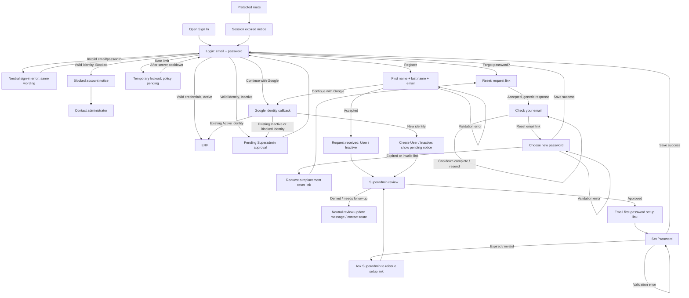

# Hope, Inc. ERP — Task 2: Authentication wireframes

## Assumptions and decisions

- **Approved role/status requirement:** every account created by Register or first created through Google is assigned the `User` role and `Inactive` (pending approval). A **Superadmin** approves the account. Registration and Google account creation do not grant application access. Only an approved, `Active` account may continue into the ERP.
- The project context defines roles `superadmin`, `admin`, and `user`, and statuses Active, Inactive, and Blocked. Existing global DEV instructions say signups default to Superadmin; that conflicts with this Task 2 requirement. The account lifecycle in these wireframes follows the explicit Task 2 review correction: new accounts are User/Inactive in all environments. Resolve/update that DEV instruction before implementation; do not silently grant Superadmin to a public signup.
- Register collects First name, Last name, and Email only. After submission, show a generic request-received confirmation. A Superadmin reviews the request. If approved, the user receives a first-password setup link, sets a password, then returns to Sign In. Approval/rejection notification content is not defined; rejection must not activate the account.
- Continue with Google creates/links an identity only after a provider callback. A newly created Google identity receives `User` + `Inactive`; it sees a pending-approval notice and cannot access protected ERP data until a Superadmin approves it. Existing Google-linked accounts must also pass the same Active-status gate. Account linking, duplicate-email handling, and provider verification are security decisions still to confirm.
- Sign In uses email/password or Continue with Google. Remember me is a persistent-session preference; its lifetime and device policy need product/security approval.
- Password creation occurs only on Set Password and Reset Password, not on Register. The exact password rules are pending product/security approval. The displayed checklist is a **provisional example only**: minimum 12 characters, uppercase, lowercase, number, symbol. Use identical provisional rules on both password-setting screens until approved.
- Lockout thresholds/duration, invite/reset token lifetime and one-time semantics, resend cooldown, registration availability, and approval notification behavior are **pending product/security decisions**, not settled requirements. Wireframe values, when shown, are labeled provisional. Do not implement them as approved policy.
- Visuals are low-fidelity grayscale: Task 1 cream page background and primary action color are retained, as are existing error/success tokens and focus token for accessibility. Other surfaces, borders, and text use Task 1 neutral tokens. The only branding element is a text logo placeholder.

## Gaps found in Task 1

Task 1 defines the reusable input/password input, buttons, card, inline errors, tokens, typography, and breakpoints. It does not define the following, which are composed from existing components in the wireframes rather than introduced as new design-system components:

- Google identity-provider button and Remember me checkbox composition.
- Registration status message, Superadmin approval / rejection messaging, and Google-created-account pending gate.
- Password checklist and strength indicator.
- Submission error summary and focus behavior.
- Session-expiry, generic sign-in failure, pending/blocked account, loading form, and registration-closed compositions.
- Generic reset confirmation, resend cooldown, one-time-link expiry, and replacement-link recovery.
- Auth-specific card width and content rhythm.

Use the existing Task 1 variables unchanged, including `--color-page`, `--color-surface`, `--color-border`, `--color-text-primary`, `--color-text-secondary`, `--color-text-disabled`, `--color-primary-600`, `--color-primary-700`, `--color-primary-800`, `--color-focus`, and existing success/danger tokens. No new color, font, or design-system component is introduced.

## Flow diagram

## Shared layout and interaction rules

- Use the Task 1 `--color-page` cream canvas and centered `--color-surface` auth card. No app sidebar. Keep the same logo placeholder, heading/helper, form, primary action, provider option, and secondary links in the same order on every applicable screen.
- Auth card maximum width: 440px; desktop/tablet padding 24px, 375px mobile padding 16px. At mobile use 16px page gutters and at least 44×44px hit areas for input, checkbox, toggle, button, and links.
- Show 1440px desktop, 768px tablet, and 375px mobile previews for every state. At 768px and below, maintain one centered column and no app navigation.
- Use Task 1 typography and tokens. Preserve its visible `--color-focus` ring. Text/background contrast must meet Task 1 thresholds (4.5:1 normal text, 3:1 large text and meaningful controls/focus). Color always pairs with a textual message or icon.
- Validation: validate required fields and format on blur; after the first error, revalidate on input. On submit, block only if required fields are invalid, show a top summary and field-level messages, then focus the summary. Server errors are linked to relevant inputs and announced. Pressing Enter submits.
- Tab order follows the numbered callouts and visible order. Initial focus: Email on Login/Reset Request; First name on Register; first password field on Set/Choose Password. If arriving with session expired, focus the session notice, then Tab to Email.
- Email: `autocomplete="email"`; First name: `given-name`; Last name: `family-name`; Login password: `current-password`; new/confirm password: `new-password`.
- Show/hide has `Show password` / `Hide password` accessible names and never submits the form. Remember me uses a labeled checkbox.
- During loading disable editable fields and duplicate submit, retain values, set `aria-busy="true"`, and show a readable spinner label. Continue with Google has its own loading/error state and must not silently fall back to password auth.
- Pending/blocked status is only disclosed after the user proves identity (valid password or successful Google callback). Before identity verification, invalid credentials use the same neutral message and response path for unknown email and wrong password.

## Password checklist shown on Set Password and Reset Password

The checklist below is provisional and must remain marked “Example policy — pending approval” until security/product approves it:

1. At least 12 characters.
2. At least one uppercase letter.
3. At least one lowercase letter.
4. At least one number.
5. At least one symbol.

Show a visible pass/fail text and icon per rule. The strength indicator is supporting feedback only; it does not replace requirements. Reevaluate as the user types. If the policy changes, apply the exact same approved rules to both password-setting screens.

## Screen 1 — Login / Sign In

- **Heading:** Sign In
- **Helper:** Sign in to your Hope account.
- **Fields/options:** Email; Password with Show/Hide; Remember me checkbox.
- **Actions:** Forgot password?; primary `Sign In`; secondary `Continue with Google`; link `Register`.

| State | Visible copy and behavior |
|---|---|
| Default | `Email`; `Password`; `Remember me`; `Forgot password?`; `Sign In`; `Continue with Google`; `New to Hope? Register`. |
| Email focus | Visible Task 1 focus ring. Initial focus is Email. |
| Empty/invalid fields | Summary `Check the highlighted fields.` Email `Enter your email address.` or `Enter a valid email address.` Password `Enter your password.` |
| Invalid credentials | Neutral summary and field-level message: `We couldn't sign you in with those details. Check your email and password, then try again.` Same message for unknown email and incorrect password; do not reveal registration status. |
| Pending account | Only after valid credentials/provider callback: `Your account is pending Superadmin approval. You can sign in after it is approved.` This confirms status after identity verification, not from an unverified email. |
| Blocked account | Only after valid credentials/provider callback: `This account can't sign in right now. Contact your administrator for help.` Avoid status disclosure before identity proof. |
| Too many attempts | `Sign-in is temporarily unavailable. Try again later.` Lock duration/threshold are pending; show server-provided retry time if policy approves. |
| Loading | Password submit: `Signing in…`; Google: `Connecting to Google…`. Disable form controls relevant to the in-flight action; preserve the other method only if safe. |
| Success | `Signed in. Opening Hope…` then navigate to ERP only for Active accounts. |
| Session expired | `Your session expired. Sign in again to continue.` Focus this notice; after successful sign-in return to original protected destination. |
| Google error/cancel | `Google sign-in didn't finish. Try again or use your email and password.` Do not create a second account on cancellation. |

**Numbered behavior callouts**

1. Initial focus Email; tab sequence: Email → Password → Show/Hide → Remember me → Forgot password? → Sign In → Continue with Google → Register.
2. Remember me is optional and its persistence duration is pending security/product approval.
3. Generic invalid-credentials message is identical regardless of whether email exists.
4. Pending/blocked notice occurs after valid identity proof. Neither state reaches the ERP.
5. OAuth callback must enforce the same User/Inactive approval policy for new Google accounts and require Active status for existing accounts.

## Screen 2 — Register

- **Heading:** Register
- **Helper:** Request access to Hope. A Superadmin must approve new accounts.
- **Fields:** First name; Last name; Email.
- **Note:** `New accounts are created as User and remain pending Superadmin approval.`
- **Actions:** `Register`; `Continue with Google`; `Already have an account? Sign In`.

| State | Visible copy and behavior |
|---|---|
| Default | Three labeled fields, pending-role note, `Register`, `Continue with Google`, `Already have an account? Sign In`. No password fields on Register. |
| Field validation | Summary `Check the highlighted fields.` First name `Enter your first name.` Last name `Enter your last name.` Email `Enter your email address.` / `Enter a valid email address.` |
| Duplicate/conflicting email | Privacy-safe summary `We couldn't complete this request. If you already have an account, Sign In or reset your password. Otherwise check the email and try again.` Links `Sign In` and `Forgot password?` |
| Loading | `Submitting request…`; disable fields and duplicate request. |
| Success | Heading `Request received`; `Your request is pending Superadmin approval. We’ll email you after it’s reviewed. If approved, we’ll send a link to set your password.` Link `Back to Sign In`. Account is User/Inactive; no ERP access yet. |
| Registration closed | Heading `Registration is unavailable`; `New requests aren't available right now. Contact your administrator for access.` Link `Back to Sign In`. Availability is pending product decision. |
| Google loading/error | `Connecting to Google…`; on failure `Google sign-in didn't finish. Try again or use the registration form.` |
| Google success: new account | Create role User/status Inactive; heading `Request received`; `Your Google account is linked. A Superadmin must approve your access before you can use Hope.` |
| Google success: existing status | Active: continue to ERP. Inactive: show pending approval message. Blocked: show neutral blocked message only after provider identity is verified. |

**What happens after registration**

The request does not set a password or grant access. A Superadmin approves the User/Inactive account. On approval, email registration receives a first-password setup link; the user sets a password, then signs in. Google registration uses the verified Google identity instead of a password-setting step; after Superadmin approval, the user signs in with Google. Rejected requests stay inactive and do not receive access. Approval/rejection email wording and a follow-up route are pending product decisions.

**Numbered behavior callouts**

1. Initial focus First name; tab sequence: First name → Last name → Email → Register → Continue with Google → Sign In.
2. Names use `given-name` and `family-name`; email uses `email`.
3. Duplicate response stays neutral to avoid email enumeration; do not return account-existence-specific timing or copy.
4. Assign `User`/`Inactive` atomically for both email and Google-created identities. Never honor client-supplied role/status.
5. Superadmin approval is required before protected access; email users receive the setup link after approval; Google users return via Google after approval.

## Screen 3 — Set Password (approved email account)

- **Heading:** Set your password
- **Helper:** Choose a password to finish setting up your Hope account.
- **Fields:** Email (read-only); New password; Confirm password; provisional checklist.
- **Action:** `Save`.

| State | Visible copy and behavior |
|---|---|
| Default | Email from validated approval link; New password; Confirm password; labeled provisional checklist; `Save`. |
| Validation errors | Summary `Check the highlighted fields.` New password `Meet each password rule below.` Confirm password `These passwords don't match. Check both fields and try again.` |
| Loading | `Saving password…`; disable form and duplicate submission. |
| Success | Heading `Password set`; `Your password is ready. Sign in to continue.` Action `Back to Sign In`. |
| Expired/invalid link | `This setup link can't be used. Ask your Superadmin to send a new one.` Distinguish expired from malformed only if doing so does not disclose identity. Link `Back to Sign In`. |

**Numbered behavior callouts**

1. Initial focus New password; tab sequence: New password → Show/Hide → Confirm password → Show/Hide → Save → Back to Sign In.
2. Email is visibly labeled/read-only and bound to the approved account.
3. Link validity, single use, and expiry are pending security approval; server owns token validity.
4. Superadmin approval is the only transition from Inactive to Active; even after approval, an email account cannot sign in until password setup completes.

## Screen 4 — Forgot Password: Request Reset

- **Heading:** Forgot password?
- **Helper:** Enter your email address. If an account matches, we'll send reset instructions.
- **Field:** Email. **Actions:** `Send Reset Link`; `Back to Sign In`.

| State | Visible copy and behavior |
|---|---|
| Default | Email label; `Send Reset Link`; `Back to Sign In`. |
| Validation | Summary `Check the highlighted field.` Email `Enter your email address.` / `Enter a valid email address.` |
| Loading | `Sending reset link…`; disable duplicate submit. |
| Request accepted | Go to Check Your Email with neutral copy for every email: `If an account matches that email, we'll send a reset link. Check your inbox and spam folder.` |
| Request error | `We couldn't process that request right now. Try again.` No account lookup details. |

**Numbered behavior callouts**

1. Initial focus Email; tab sequence: Email → Send Reset Link → Back to Sign In.
2. The response, status code presented to the UI, and timing must not reveal whether the email is registered.

## Screen 5 — Forgot Password: Check Your Email

- **Heading:** Check your email
- **Helper:** If an account matches that email, we'll send a reset link. Check your inbox and spam folder.
- **Actions:** `Resend link` (subject to approved cooldown); `Back to Sign In`.

| State | Visible copy and behavior |
|---|---|
| Confirmation / cooldown | `You can request another link when the timer ends.` The duration is pending security/product approval. |
| Resend available | `Resend link`. |
| Resend loading | `Sending reset link…`; prevent duplicate request. |
| Resend success | `If an account matches that email, we'll send a new reset link.` Restart server-controlled cooldown. |
| Resend error | `We couldn't send a link right now. Try again later.` Keep Back to Sign In. |

**Numbered behavior callouts**

1. Initial focus heading/status summary, announced to assistive technology; then tab sequence: Resend link → Back to Sign In.
2. Never display whether the address exists. Avoid full email on shared screens; if shown, mask it per approved policy.
3. Cooldown length and retry display are pending decisions; client timer is presentation only, server enforces rate limits.

## Screen 6 — Set/Reset Password: Choose New Password

- **Heading:** Choose a new password
- **Helper:** Create a new password for your Hope account.
- **Fields:** New password; Confirm password; same provisional checklist as Screen 3.
- **Action:** `Save`.

| State | Visible copy and behavior |
|---|---|
| Default | Show fields only after reset-link validation; checklist identifies itself as provisional until approved. |
| Validation | Summary `Check the highlighted fields.` New password `Meet each password rule below.` Confirm password `These passwords don't match. Check both fields and try again.` |
| Loading | `Saving password…`; prevent duplicate submit. |
| Success | Heading `Password reset`; `Your password has been updated. Sign in with your new password.` Action `Back to Sign In`. |
| Expired link | Heading `This reset link has expired`; `Request a new link to reset your password.` Action `Request a new reset link` → Forgot Password request. |
| Invalid/already-used link | Heading `This reset link can't be used`; `Request a new link to continue.` Action `Request a new reset link` → Forgot Password request. |
| Save error | `We couldn't update your password right now. Try again.` Preserve field values unless the token is invalid; on invalid token use the recovery state. |

**Numbered behavior callouts**

1. Initial focus New password; tab sequence: New password → Show/Hide → Confirm password → Show/Hide → Save → Back to Sign In.
2. Same approved policy as Screen 3; current checklist is explicitly provisional.
3. On success return to Sign In; do not automatically sign in.
4. Expired and invalid links always have a replacement-link path back to Forgot Password.

## Complete microcopy table

| Context | Exact copy |
|---|---|
| Login heading | `Sign In` |
| Login helper | `Sign in to your Hope account.` |
| Field labels | `Email`; `Password`; `First name`; `Last name`; `New password`; `Confirm password` |
| Login options | `Remember me`; `Forgot password?`; `Sign In`; `Continue with Google`; `New to Hope? Register` |
| Register helper | `Request access to Hope. A Superadmin must approve new accounts.` |
| New-account note | `New accounts are created as User and remain pending Superadmin approval.` |
| Register actions | `Register`; `Continue with Google`; `Already have an account? Sign In` |
| First name errors | `Enter your first name.` |
| Last name errors | `Enter your last name.` |
| Email errors | `Enter your email address.`; `Enter a valid email address.` |
| Password empty | `Enter your password.` |
| Password policy | `Meet each password rule below.` |
| Password mismatch | `These passwords don't match. Check both fields and try again.` |
| Submission summary | `Check the highlighted fields.` |
| Generic sign-in error | `We couldn't sign you in with those details. Check your email and password, then try again.` |
| Pending account | `Your account is pending Superadmin approval. You can sign in after it is approved.` |
| Blocked account | `This account can't sign in right now. Contact your administrator for help.` |
| Generic lockout | `Sign-in is temporarily unavailable. Try again later.` |
| Session expired | `Your session expired. Sign in again to continue.` |
| Google error | `Google sign-in didn't finish. Try again or use your email and password.` |
| Google loading | `Connecting to Google…` |
| Password sign-in loading | `Signing in…` |
| Temporary lockout | `Sign-in is temporarily unavailable. Try again later.` |
| Registration received | `Your request is pending Superadmin approval. We’ll email you after it’s reviewed. If approved, we’ll send a link to set your password.` |
| Google pending | `Your Google account is linked. A Superadmin must approve your access before you can use Hope.` |
| Registration closed | `New requests aren't available right now. Contact your administrator for access.` |
| Registration loading | `Submitting request…` |
| Reset heading/helper | `Forgot password?`; `Enter your email address. If an account matches, we'll send reset instructions.` |
| Reset actions | `Send Reset Link`; `Back to Sign In` |
| Generic reset confirmation | `If an account matches that email, we'll send a reset link. Check your inbox and spam folder.` |
| Resend success/error | `If an account matches that email, we'll send a new reset link.`; `We couldn't send a link right now. Try again later.` |
| Reset request loading | `Sending reset link…` |
| Resend loading | `Sending reset link…` |
| Resend cooldown | `You can request another link when the timer ends.` |
| Set password heading/helper | `Set your password`; `Choose a password to finish setting up your Hope account.` |
| New password heading/helper | `Choose a new password`; `Create a new password for your Hope account.` |
| Password save | `Save`; `Saving password…` |
| Set password success | `Your password is ready. Sign in to continue.` |
| Reset success | `Your password has been updated. Sign in with your new password.` |
| Setup-link error | `This setup link can't be used. Ask your Superadmin to send a new one.` |
| Setup-link action | `Request a new setup link` |
| Reset-link expired | `Request a new link to reset your password.` |
| Reset-link invalid/used | `Request a new link to continue.` |
| Generic request error | `We couldn't process that request right now. Try again.` |
| Generic save error | `We couldn't update your password right now. Try again.` |

## Open product/security decisions

1. Confirm or update the DEV signup default (`superadmin`) because it conflicts with the required User/Inactive lifecycle.
2. Approve password policy and strength-meter behavior; checklist currently shows an example only.
3. Set lockout/rate-limit thresholds and duration; wireframe does not prescribe a final value.
4. Approve reset/invite token expiry, single-use behavior, resend cooldown, and attempt limits.
5. Confirm whether registration is open, closed, or organization-configurable.
6. Confirm Superadmin approval/rejection/clarification workflow and notification copy.
7. Confirm Google account linking, verified-email requirements, duplicate-email behavior, and whether an existing non-Google account can be linked.
8. Confirm persistence semantics for Remember me and OAuth sessions.
9. Confirm support/contact destination and who can reissue an approved account's setup link.
10. Confirm whether login after password set should always return to Sign In (wireframes say yes).

## Review checklist

- [x] New email and Google accounts are User/Inactive and require Superadmin approval.
- [x] Register has First name, Last name, Email, Register, Google option, and Sign In link; no password fields.
- [x] Login has Email, password show/hide, Remember me, Forgot password, Sign In, Google option, and Register link.
- [x] Reset confirmation and errors are privacy-safe; login credential error is identical for unknown email and wrong password.
- [x] Pending/blocked messages appear only after identity verification.
- [x] Every screen/state has desktop, tablet, and mobile wireframes, field copy, initial focus, tab order, and numbered behavior notes.
- [x] Reset success returns to Login; expired/invalid links offer a replacement path.
- [x] Password policy, lockout, cooldown, and link expiry are explicitly pending approval.
- [x] Colors/fonts/component patterns reuse Task 1; low-fidelity screens are grayscale apart from cream page, primary action, focus, errors, and success.
