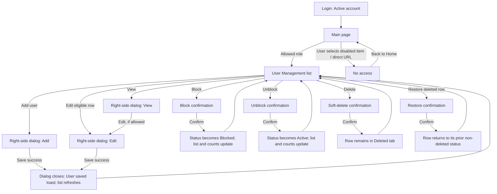

# Hope, Inc. ERP — Task 3: Main page and user management wireframes

## Assumptions

- The project context defines the roles **Superadmin**, **Admin**, and **User**, and the statuses **Active**, **Inactive**, and **Blocked**. The design system adds a soft-deleted row state; Deleted is a list filter, not an account status.
- Superadmins can manage all users. Admins can manage Users only; they can view but not edit Admin and Superadmin records. Users cannot use User Management: the sidebar item is disabled with an explanation, and direct access shows No access.
- Delete is a soft delete. Deleted rows remain available in the Deleted tab and can be restored. No permanent-delete action is shown.
- The right-side panel is the Task 1 Modal / dialog pattern composed as a right-anchored form panel: Add, Edit, and View use the same accessible panel; the footer stays visible while the body scrolls.
- Add user follows the current Task 3 implementation: an Admin enters first name, last name, email, and a temporary password; the account is created as an approved User, and the user must change the password at first sign-in. Confirm this approval policy with the product owner.
- User records have Full name, Email, Role, Status, Created, Last edited, and (when deleted) Deleted audit details. No other user fields or permission assignments are defined in the project context.
- The project context names no business modules besides User Management. The sidebar therefore shows Home and User Management only; no speculative HR, CRM, Product, or Sales modules or dashboard metrics are added.
- Sample identities and dates below are illustrative and not real account data.

## Gaps found in Task 1

- No right-side drawer variant is specified for the Task 1 Modal / dialog. This wireframe anchors that existing dialog pattern to the right; it does not introduce a new component.
- The task requests a collapsed sidebar at the 768px tablet preview, while Task 1 specifies a navigation drawer at 768px and below. The sheet follows the task-specific tablet requirement (collapsed at 768px) and shows the drawer at 375px; confirm the breakpoint before implementation.
- No dashboard summaries, modules beyond User Management, or additional Quick Actions are named. Home uses only the User Management actions a role is allowed to perform.
- No detailed authorization matrix, Admin role-assignment rules, manual-account approval lifecycle, or account-created email timing is defined. The role rules requested for this task are shown as product assumptions pending confirmation.
- No bulk-action bar, responsive user-card layout, or No access screen is specified. These are compositions of the existing Data table, Buttons, Status badge and role pill, and Alert patterns.
- Task 1 specifies audit stamps as `CREATED / EDITED / DELETED · {user} · {date}`. The wireframes use that exact pattern rather than the alternate “by/on” wording in the request.
- The iconography section requires an established icon family, but none is included in the repository. The sheet uses simple text symbols only as wireframe placeholders; replace them with the approved icon set before implementation.

## Role permission matrix

| Screen / action | Superadmin | Admin | User |
|---|---|---|---|
| Home | See home and User Management quick actions | See home and User Management quick actions | See home; no management actions |
| User Management navigation | Enabled | Enabled | Disabled with “You don’t have access to User Management.” |
| Open User Management directly | Full list and all user records | User records; Admin/Superadmin records are view-only | No access state with a Back to Home action |
| Add a user | Add users; role choices need confirmation | Add Users only | Not available |
| View user | All roles | All roles, including read-only Admin/Superadmin records | Not available |
| Edit user | All users, including Admins | Users only | Not available |
| Change status | Block / unblock users except self | Block / unblock Users except self | Not available |
| Soft-delete / restore | Any user except self | Users except self | Not available |
| Bulk actions | Delete or block eligible selected records | Delete or block eligible selected Users | Not available |
| Manage own record | Cannot block or delete self | Cannot block or delete self | No User Management access |

Admins never receive controls that mutate an Admin or Superadmin record. In mixed selections, bulk actions apply only to eligible Users; the selection summary names the eligible count before confirmation. Exact role assignment, mixed-selection policy, and whether an Admin can edit their own profile in another screen need product confirmation.

## Flow diagram

## Screen 1 — Main page (Home)

**Shell:** expanded 256px sidebar on desktop; collapsed 72px icon-only sidebar on tablet (768px, per this task); hidden behind a dismissible drawer on mobile (375px). Content is centered at max-width 1200px, with 32px desktop, 24px tablet, and 16px mobile page gutters.

**Shared frame:** Home title; signed-in user and role pill; Log out; greeting `Good morning, {first name}.`; Quick Actions; no dashboard metrics because none are defined in project context.

### Home role variants

| Role | Quick Actions | Navigation |
|---|---|---|
| Superadmin | `Add user` — Create a User account with a temporary password; the user must change it at first sign-in. `View users` — Search and manage accounts. | Home active; User Management enabled. |
| Admin | `Add user` — Create a User account with a temporary password; the user must change it at first sign-in. `View users` — Search and manage Users. | Home active; User Management enabled. |
| User | `No management shortcuts are available for your role.` | Home active; User Management disabled with an access explanation. |

### States

| State | Content |
|---|---|
| Default | Greeting, role-appropriate Quick Actions, and a short `Choose an action to get started.` helper. |
| Loading | `Loading your home page…`; skeleton greeting and two Quick Action cards; `aria-busy="true"`. |
| Empty | `There’s nothing to show yet.` `You can still use the actions available to your role.` Preserve permitted Quick Actions. |
| Mobile menu open | Drawer covers the page, exposes the same role-aware items, and has a `Close menu` control. Selecting a destination closes it. |
| User opens User Management | No access page: `You don’t have access to User Management.` `Ask a Superadmin if you need access.` Action: `Back to Home`. |

### Numbered behavior callouts

1. Home is the landing page after successful sign-in; use the signed-in user’s actual name and role, never sample identity in production.
2. Quick Action cards are whole-card links/buttons. Superadmin and Admin see only actions permitted by their role; User sees no management actions.
3. Only Home and User Management are shown because no other product modules are documented.
4. On desktop the sidebar is 256px; at the 768px tablet preview it is 72px and icon-only with accessible names/tooltips; at the 375px mobile preview it is behind a dismissible drawer. This follows the task-specific tablet instruction; reconcile with Task 1's 768px drawer breakpoint.
5. Disabled User Management remains readable and exposes the reason. Direct URL access returns the same No access message without rendering protected user data.
6. Loading and empty states do not hide the navigation, role, or Log out action.

## Screen 2 — User Management list

**Header:** `User Management`; `View and manage Hope accounts.`; primary `Add user` (Superadmin/Admin only).

**Tabs:** `All 24`, `Active 16`, `Inactive 4`, `Blocked 2`, `Deleted 2`. Counts are illustrative; production counts come from the current authorized result set and update after each successful mutation.

**Filters:** labeled `Search users` field with `Search by name or email`; `Role` filter; `Clear filters` only while a filter is active. Search is debounced for remote results, with immediate local feedback.

**Columns:** selection checkbox; Name; Email; Role; Status; Created; Last edited; Actions. Name, Email, Role, Status, Created, and Last edited are sortable; active sort shows a direction and `aria-sort`.

### List states

| State | Wireframe behavior and copy |
|---|---|
| Default | Illustrative rows: Maria Santos (`maria.santos@hope.example`, User, Active); Carlo Reyes (`carlo.reyes@hope.example`, User, Inactive); Ana Dela Cruz (`ana.delacruz@hope.example`, Admin, Active); Paolo Garcia (`paolo.garcia@hope.example`, User, Blocked); Liza Mendoza (`liza.mendoza@hope.example`, User, Deleted). Each row has an Actions menu with accessible name `Actions for {name}`. |
| Hover / focus | Row surface changes using an existing surface token; keyboard focus has the visible Task 1 focus ring. Row actions are visible without hover and keyboard reachable. |
| Selected | Selected row has checked checkbox and selected surface. Bulk bar: `{n} selected`; `Block`; `Delete`; `Clear selection`. For Admin, the count and actions include eligible Users only. |
| Header checkbox unchecked | No rows selected; checkbox exposes unchecked state. |
| Header checkbox checked | All eligible visible rows on the current page selected; checkbox exposes checked state. |
| Header checkbox indeterminate | Some eligible visible rows selected; checkbox exposes `mixed`. |
| Soft-deleted | Shaded with `--color-row-deleted`, readable content, `DELETED · Maya Chen · 28 Oct 2026, 09:20` stamp, and `Restore` action. No permanent delete. |
| Blocked | Status badge says `⊘ Blocked`; Actions menu offers `Unblock`. |
| Loading | Announced `Loading users…`; header and toolbar remain stable; show skeleton rows and `aria-busy="true"`. |
| No users yet | `No users yet`; `Add a user to get started.` Action `Add user` for authorized roles. |
| No search results | `No users match your search.` `Try a different name or email, or clear your filters.` Action `Clear filters`. |
| No results in tab | `No {status} users.` `Choose another status or clear your filters.` Action `Clear filters`. |
| Error | `We couldn’t load users.` `Check your connection and try again.` Action `Try again`; keep filter values. |
| No access | `You don’t have access to User Management.` `Ask a Superadmin if you need access.` Action `Back to Home`; do not render table data. |

### Row actions and confirmations

| Row / selection | Available actions |
|---|---|
| Eligible active User | View, Edit, Block, Delete |
| Eligible inactive User | View, Edit, Block, Delete |
| Eligible blocked User | View, Edit, Unblock, Delete |
| Eligible deleted User | View, Restore |
| Admin viewing Admin/Superadmin row | View only; Edit, Block/Unblock, Delete are omitted |
| Current user's own row | View/Edit as role permits; Block and Delete disabled with `You can’t block or delete your own account.` |
| Selected eligible users | Bulk bar shows eligible count; `Block` and `Delete` open named-count confirmations. Ineligible selected rows are excluded and called out before action. |

### Responsive and table behavior

- Desktop/tablet use the Data table with all specified columns and horizontal scrolling when needed; keep Name visible as the first data column. Actions remain in a menu, never hover-only.
- Mobile switches each row to a stacked card: Name + Role + Status first; Email, Created, and Last edited below; selection checkbox and Actions menu remain reachable with 44×44px hit areas. The card has a visible label for each field.
- Rows-per-page selector: `Rows per page`; options 10, 25, 50. Pagination: `Previous`, numbered pages, `Next`; summary `Showing 1 to 10 of 24`.
- Changing tab, search, role filter, sort, or page clears the current selection. After an action, refresh rows and counts; keep the current tab if possible, otherwise select All.

### Numbered behavior callouts

1. Search accepts name/email, debounces remote requests, and exposes a clear control and result count. `Clear filters` clears search, role, and sort filters and returns to All.
2. Status counts refresh with authorized data after actions; Deleted is a soft-delete view, not a fourth account status.
3. Sortable headers expose direction using a label/icon and `aria-sort`, not color alone. Default sort is Last edited, newest first; confirm this default.
4. Selection is page-scoped, cleared on tab/filter/page changes, and never silently applies to hidden rows.
5. Header checkbox selects eligible rows on the current page; indeterminate means some but not all eligible visible rows are selected.
6. Actions menus are keyboard-operable and named for their row. Mobile uses the same actions without requiring hover.
7. Admin never receives mutation actions for Admin/Superadmin records. User receives no list data even if they navigate directly to the URL.
8. The current user cannot Block or Delete their own account; disabled action includes the reason in adjacent text and its accessible description.
9. Delete is soft: row is retained, shaded, stamped, and recoverable through Restore. Block prevents login; it is not deletion.
10. Use `Try again` for load errors. Empty and no-access states always include a next action.

## Screen 3 — Right-side dialog: Add / Edit / View user

**Overlay and panel:** dimmed list behind the panel; desktop panel width 480px, tablet 420px, mobile full-screen. Header remains visible, body scrolls, footer sticks to the bottom. Footer order: `Cancel`, then `Save` (single primary). View mode uses `Close` and an `Edit` action when permitted.

**Add fields:** First name; Last name; Email address; Temporary password. The current implementation creates an approved User and requires a password change at first sign-in. The Add flow does not expose Role or Status fields.

**Edit/View fields:** Full name; Email; Role; Status. Admin can edit Users only; role assignment beyond User requires product confirmation. Status choices are Active, Inactive, Blocked; deleted records use Restore rather than a status selector. No permission checkboxes are shown because no per-module permissions are required by project context.

### Dialog modes and states

| Mode / state | Content and behavior |
|---|---|
| Add — default | Required First name, Last name, Email address, and Temporary password fields; note that the account is an approved User and must change the password at first sign-in; footer `Cancel` / `Create user`. Share the temporary password securely. |
| Add — validation | `Please correct the highlighted fields.` First name: `Enter a first name (maximum 80 characters).` Last name: `Enter a last name (maximum 80 characters).` Invalid email: `Enter a valid email address.` Temporary password: `Temporary password must be between 8 and 128 characters.` |
| Add — loading | Prevent duplicate submission; primary action shows `Creating user…` and announce `Creating user…`. |
| Add — success | Confirm user creation, update list/counts, and remind the Admin to share the temporary password securely. The user must change it at first sign-in. |
| Add — error | Keep the result explicit: `We couldn’t create that account. Check the email and password requirements.` If the account exists but profile creation fails, explain that support is needed rather than implying success. |
| Edit — Superadmin editing Admin | Filled fields and editable role/status; footer `Cancel` / `Save`. Show CREATED and EDITED stamps. |
| Edit — Admin editing User | Filled fields; role constrained to User; status editable; footer `Cancel` / `Save`. Show CREATED and EDITED stamps. |
| View — permitted | Read-only labels and values; stamps at end; `Close`; `Edit` if the current role may edit this record. |
| View — Admin viewing Admin/Superadmin | Read-only values and stamps; no Edit action. This is the view-only example for a user without edit permission. |
| Field focus | Focused control uses a 2px `--color-focus` outline and 2px offset. |
| Save error | Inline top alert: `We couldn’t save this user. Check your connection and try again.` Preserve values and field errors. |
| Unsaved changes | Closing with changed fields opens a confirmation: `Discard your changes?` `Your edits haven’t been saved.` Actions `Keep editing` / `Discard changes`. Escape follows the same warning. |

### Audit stamps

Use the exact Task 1 format, at 12px or larger:

- `CREATED · Maya Chen · 26 Oct 2026, 14:32`
- `EDITED · Alex Rivera · 30 Oct 2026, 11:08`
- `DELETED · System · 31 Oct 2026, 09:15`

Add mode has no stamps until creation succeeds. Edit and View show Created and Last edited; show Deleted only for a soft-deleted record.

### Numbered behavior callouts

1. Opening the panel moves focus to its accessible title or first field. Trap Tab/Shift+Tab inside, close with Escape when safe, and return focus to the opener.
2. Body scrolls independently; header and footer remain visible. Backdrop click never discards unsaved work.
3. Validate required fields and email format on blur; after the first error, revalidate on input. Duplicate-email error comes from the server and preserves other values.
4. During save, disable editable fields and duplicate Save; retain values and announce loading. On error, keep the panel open and show inline guidance.
5. Success closes the panel, updates list data/counts, and announces `User saved` in a polite live region for long enough to read.
6. Admin can edit Users only. When viewing an Admin/Superadmin, render read-only fields and no Edit action. Do not rely on disabled controls to protect data; enforce permissions server-side.
7. Add user matches the current Task 3 implementation: create an approved User with a temporary password, then require a password change at first sign-in. Confirm the immediate-approval policy with the product owner.
8. Close button, Cancel, and Escape share the unsaved-changes guard. `Keep editing` restores focus to the last edited field.
9. No permissions checkbox group is included; add one only if the product context later requires per-module access.

## Screen 4 — Centered confirmation dialogs

Confirmation dialogs use the Task 1 destructive confirmation dialog pattern; Cancel receives initial focus. Identify the target and consequence in text, keep the safe action visually first, and prevent duplicate submissions while loading.

| Action | Title and message | Actions |
|---|---|---|
| Delete one | `Delete user?` `Maria Santos (maria.santos@hope.example) will be soft-deleted. The record stays in Deleted and can be restored.` | `Cancel` / danger `Delete user` |
| Block one | `Block user?` `Maria Santos (maria.santos@hope.example) won’t be able to log in until the account is unblocked.` | `Cancel` / danger `Block user` |
| Unblock | `Unblock user?` `Maria Santos will be able to sign in again if the account is Active.` | `Cancel` / `Unblock user` |
| Restore | `Restore user?` `Maria Santos will return to the user list with the previous account status.` | `Cancel` / `Restore user` |
| Bulk delete | `Delete 3 users?` `These records will be soft-deleted and can be restored from Deleted.` | `Cancel` / danger `Delete 3 users` |
| Bulk block | `Block 3 users?` `These users won’t be able to log in until their accounts are unblocked.` | `Cancel` / danger `Block 3 users` |
| Self-protection | Block/Delete are disabled for the current user's own row. Helper/tooltip: `You can’t block or delete your own account.` | No confirmation can be opened. |
| Confirmation loading | Keep the dialog open, prevent duplicate action, and announce the in-progress operation. | `Deleting…`; `Blocking…`; `Unblocking…`; or `Restoring…` |
| Confirmation error | Keep the dialog open and explain how to recover. | `We couldn’t complete this action. Try again.` |

Block has no reason field: the project context does not require one. If product later requires a reason, add it as a labeled field and validate it before confirmation.

### Numbered behavior callouts

1. Confirmation opens from the row or bulk action and names the exact person/count. The message explains the effect; Delete explicitly says soft-deleted and restorable.
2. Initial focus is `Cancel`; focus is trapped, Escape closes, and focus returns to the invoking action.
3. Destructive action shows progress (`Deleting…` / `Blocking…`); prevent duplicate submission. On error, keep the dialog open and say what to do next.
4. On success, close the confirmation, update the row/status and counts, and announce the result; Delete moves the row to Deleted, Block changes Status, Restore removes the Deleted state.
5. Self-block and self-delete are unavailable with a readable explanation, not color-only or hidden behind an error.
6. Bulk confirmation shows the eligible affected count. Selection is cleared after completion; ineligible rows are not silently included.

## Accessibility checks

- [x] Persistent visible labels above every input; placeholder text is not used as a label.
- [x] Dialog title is accessible; focus is trapped; Escape and focus return are specified; unsaved edits are guarded.
- [x] Confirmation dialogs focus Cancel first.
- [x] Table uses semantic header cells; sortable headings expose `aria-sort`; row actions include the user’s name.
- [x] Toast is announced through a live region and stays visible long enough to read.
- [x] Visible Task 1 focus ring, logical tab order, and 44×44px mobile targets are specified.
- [x] Status/role labels include text and icon; no status relies on color alone.
- [x] Contrast uses Task 1 token pairs; disabled labels remain readable.
- [x] Mobile menu is dismissible; drawer and dialogs have accessible names and close controls.

## Complete microcopy table

| Context | Exact copy |
|---|---|
| Home title | `Home` |
| Home greeting | `Good morning, {first name}.` |
| Home helper | `Choose an action to get started.` |
| Loading home | `Loading your home page…` |
| Empty home | `There’s nothing to show yet. You can still use the actions available to your role.` |
| Home action — add | `Add user`; `Create a User account with a temporary password; the user must change it at first sign-in.` |
| Home action — view | `View users`; `Search and manage accounts.` |
| Home no actions | `No management shortcuts are available for your role.` |
| User Management helper | `View and manage Hope accounts.` |
| User Management denied | `You don’t have access to User Management. Ask a Superadmin if you need access.` |
| Denied action | `Back to Home` |
| Search label / hint | `Search users`; `Search by name or email` |
| Role filter | `Role`; `All roles` |
| Filter reset | `Clear filters` |
| Table columns | `Name`; `Email`; `Role`; `Status`; `Created`; `Last edited`; `Actions` |
| Tabs | `All`; `Active`; `Inactive`; `Blocked`; `Deleted` |
| Row action menu | `Actions for {name}` |
| Bulk selection | `{n} selected`; `Block`; `Delete`; `Clear selection` |
| Loading users | `Loading users…` |
| No users | `No users yet. Add a user to get started.` |
| No search match | `No users match your search. Try a different name or email, or clear your filters.` |
| Empty status tab | `No {status} users. Choose another status or clear your filters.` |
| Load error | `We couldn’t load users. Check your connection and try again.` |
| Retry | `Try again` |
| Pagination summary | `Showing {start} to {end} of {total}` |
| Pagination controls | `Rows per page`; `Previous`; `Next` |
| Own-account restriction | `You can’t block or delete your own account.` |
| Add/Edit dialog title | `Add user`; `Edit user` |
| View dialog title | `User details` |
| Add fields | `First name`; `Last name`; `Email address`; `Temporary password` |
| Edit/View fields | `Full name`; `Email`; `Role`; `Status` |
| Status options | `Active`; `Inactive`; `Blocked` |
| Dialog actions | `Cancel`; `Create user`; `Save`; `Close`; `Edit` |
| Required first-name error | `Enter a first name (maximum 80 characters).` |
| Required last-name error | `Enter a last name (maximum 80 characters).` |
| Required email error | `Enter the user's email address.` |
| Invalid email | `Enter a valid email address.` |
| Duplicate email | `This email is already in use. Enter a different email address.` |
| Validation summary | `Check the highlighted fields.` |
| Add loading | `Creating user…` |
| Save loading | `Saving…`; `Saving user…` |
| Save error | `We couldn’t save this user. Check your connection and try again.` |
| Save success toast | `User saved` |
| Unsaved changes | `Discard your changes? Your edits haven’t been saved.` |
| Unsaved actions | `Keep editing`; `Discard changes` |
| Audit stamps | `CREATED · {user} · {date}`; `EDITED · {user} · {date}`; `DELETED · {user} · {date}` |
| Delete title/message | `Delete user?`; `{name} ({email}) will be soft-deleted. The record stays in Deleted and can be restored.` |
| Delete action | `Delete user` |
| Block title/message | `Block user?`; `{name} ({email}) won’t be able to log in until the account is unblocked.` |
| Block action/loading | `Block user`; `Blocking…` |
| Unblock title/message/action | `Unblock user?`; `{name} will be able to sign in again if the account is Active.`; `Unblock user` |
| Restore title/message/action | `Restore user?`; `{name} will return to the user list with the previous account status.`; `Restore user` |
| Bulk delete title/message/action | `Delete {n} users?`; `These records will be soft-deleted and can be restored from Deleted.`; `Delete {n} users` |
| Bulk block title/message/action | `Block {n} users?`; `These users won’t be able to log in until their accounts are unblocked.`; `Block {n} users` |
| Delete loading | `Deleting…` |
| Other confirmation loading | `Blocking…`; `Unblocking…`; `Restoring…` |
| Confirmation error | `We couldn’t complete this action. Try again.` |
| Mobile menu | `Open menu`; `Close menu` |

## Open questions

1. Which dashboard metrics or business modules should appear beyond User Management? None are named in the current project context.
2. Should Admin-created accounts be approved immediately as in the current implementation, or require separate approval? The current flow assigns the User role and requires a temporary-password change at first sign-in.
3. Can Admins assign only User (as shown), and which roles may Superadmins assign or change? Can users edit their own profile outside User Management?
4. In a mixed bulk selection, should ineligible records be excluded with a summary or should the whole action be blocked?
5. Should adding a user require a confirmation step? What recovery is needed if the Admin cannot securely share the temporary password after account creation?
6. Should restoring a previously Blocked/Inactive account preserve that status, or restore it as Active?
7. Should the 768px tablet sidebar be collapsed to 72px or use the Task 1 navigation drawer at and below 768px? The sheet follows the task-specific collapsed tablet requirement.
8. What is the preferred default sort, and should mobile use stacked cards or horizontal scroll? This wireframe uses Last edited descending on desktop and stacked cards on mobile.
9. Which licensed icon family should replace the HTML sheet’s text-symbol placeholders?

## Coverage checklist

- [x] Home default, loading, empty, role-specific Superadmin/Admin/User, and mobile open-menu examples.
- [x] User Management list default, hover, selected, all checkbox states, soft-deleted, blocked, loading, errors, empty states, and no-access.
- [x] Add, Edit, View, field focus, validation, save loading/success/error, unsaved warning, and permission examples.
- [x] Single and bulk Delete/Block; Unblock, Restore, and self-action restriction.
- [x] Desktop 1440px, tablet 768px, and mobile 375px views are shown for every state in the HTML sheet.
- [x] No new tokens, fonts, or core components; all undecided product behavior is listed above.
